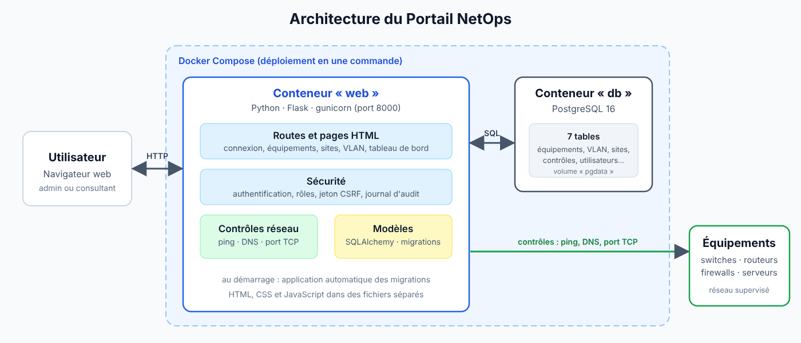

# Architecture

## Vue d'ensemble

<figure markdown>
  { width="900" }
  <figcaption>Figure 1 : architecture du portail</figcaption>
</figure>

L'application tourne dans deux conteneurs Docker (`web` et `db`) décrits dans `docker-compose.yml`. Les données de la base sont conservées dans un volume Docker.

## Trajet d'une requête

Exemple : un administrateur clique sur « Lancer le contrôle » sur la fiche d'un équipement.

1. Le **navigateur** envoie un formulaire (`POST /devices/<id>/check`) avec un jeton CSRF.
2. **Flask** vérifie le jeton, identifie l'utilisateur (Flask-Login) et son rôle (`@admin_required`).
3. La **route** (`routes/devices.py`, fonction `check`) valide les champs puis appelle `run_check`.
4. `checks.py` exécute le **ping, la résolution DNS ou la connexion TCP**.
5. Le résultat est enregistré dans la table `checks` (**modèle** `Check`, **base** PostgreSQL).
6. La route redirige vers la fiche ; le **template** `devices/detail.html` affiche l'historique.

## Organisation du code

```text
backend/
├── app/
│   ├── __init__.py        create_app() : crée l'application et branche les composants
│   ├── config.py          lecture des variables d'environnement
│   ├── extensions.py      base de données, migrations, login, CSRF
│   ├── models.py          les tables (SQLAlchemy)
│   ├── auth.py            connexion, déconnexion, décorateur @admin_required
│   ├── checks.py          contrôles ICMP, DNS, TCP et enregistrement du résultat
│   ├── stats.py           chiffres du tableau de bord
│   ├── audit.py           journal d'audit
│   ├── routes/            une route (page) par fonctionnalité : devices, sites, vlans, main
│   ├── templates/         pages HTML (Jinja2)
│   └── static/            css/style.css, js/app.js
├── tests/                 tests automatiques (pytest)
├── migrations/            évolutions du schéma (Alembic)
├── Dockerfile, entrypoint.sh
└── requirements.txt
```

Principe : le **HTML**, le **CSS** et le **JavaScript** sont dans des fichiers séparés. Les pages ne contiennent ni style ni script en ligne.

## Choix de conception

- **État d'un équipement** : c'est le résultat de son dernier contrôle, tous types confondus. Sans contrôle, l'état est « inconnu ».
- **Contrôles manuels** : ils sont lancés par un administrateur ; ils écrivent dans l'historique.
- **Doublons** : un nom ou une adresse IP est unique *par site* (deux sites peuvent réutiliser la même adresse privée).
- **Suppressions** : supprimer un équipement supprime son historique ; un site qui contient des équipements ne peut pas être supprimé.
