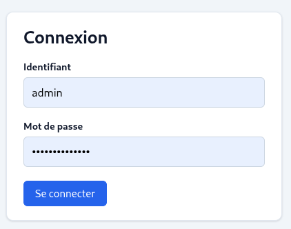
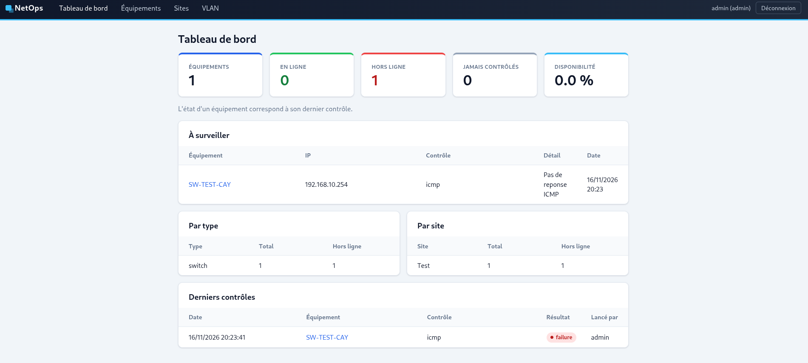
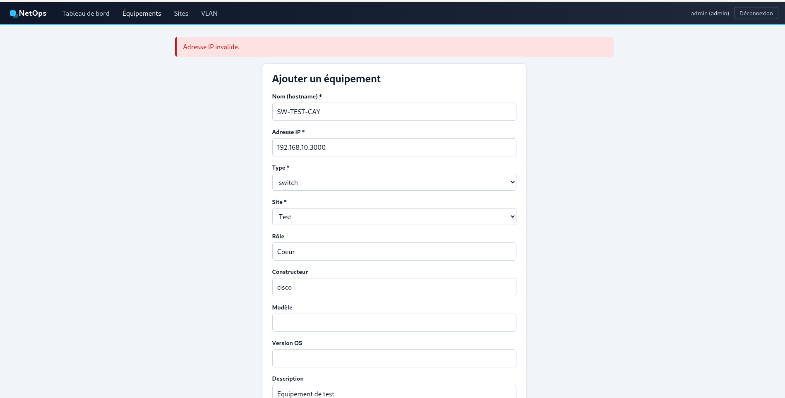

# Guide utilisateur

## Se connecter

1. Ouvrir l'adresse du portail (par exemple `http://localhost:8000`).
2. Saisir son identifiant et son mot de passe.

<figure markdown>
  { width="500" }
  <figcaption>Figure 1 : la page de connexion</figcaption>
</figure>

3. Le **tableau de bord** s'affiche. Pour quitter, cliquer sur **Déconnexion** en haut à droite.

## Lire le tableau de bord

Le tableau de bord montre : le nombre d'équipements, ceux **en ligne**, **hors ligne** et **jamais contrôlés**, la **disponibilité** en pourcentage, la liste **À surveiller** (équipements dont le dernier contrôle a échoué), la répartition par type et par site, et les derniers contrôles. **[CAPTURE : tableau de bord]**
<figure markdown>
  { width="700" }
  <figcaption>Figure 2 : le tableau de bord </figcaption>
</figure

L'état d'un équipement correspond à son **dernier contrôle**.

## Rechercher un équipement

1. Menu **Équipements**.
2. Saisir un texte (nom, adresse IP, modèle…) et/ou choisir un type, un site, un constructeur, un VLAN.
3. Cliquer sur **Filtrer** ; **Réinitialiser** efface les critères. **[CAPTURE : liste filtrée]**

## Consulter la fiche d'un équipement

Cliquer sur le nom de l'équipement : informations, VLAN associés et historique des contrôles. **[CAPTURE : fiche]**

## Actions réservées à l'administrateur

| Action | Où |
|---|---|
| Ajouter un équipement | **Équipements > Ajouter un équipement** (un site doit exister) |
| Modifier ou supprimer un équipement | Fiche de l'équipement |
| Lancer un contrôle | Fiche de l'équipement : choisir `icmp`, `dns` ou `tcp` (avec un port), puis **Lancer le contrôle** |
| Gérer les sites | Menu **Sites** |
| Gérer les VLAN | Menu **VLAN**, puis associer un VLAN à un équipement depuis sa fiche |
| Définir le VLAN d'administration | Fiche de l'équipement, bouton **Définir comme administration** |

Un utilisateur simple voit les mêmes pages mais **sans** les boutons de modification.

## Messages d'erreur courants

| Message | Signification |
|---|---|
| « Adresse IP invalide » | Saisir une adresse IPv4 ou IPv6 valide |
| « Un équipement avec cette adresse IP existe déjà sur ce site » | Une IP est unique par site |
| « Impossible de supprimer un site qui contient des équipements » | Supprimer ou déplacer d'abord les équipements |
| Erreur 403 | Action réservée à l'administrateur |

Exemple : 

<figure markdown>
  { width="700" }
  <figcaption>Figure 4 : Exemple </figcaption>
</figure>
