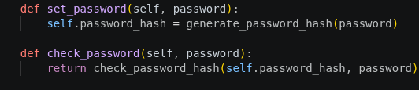
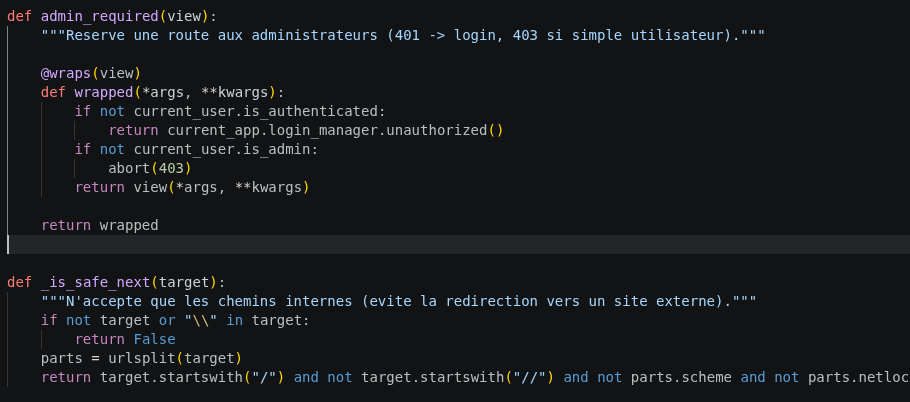

# Sécurité

## Ce qui est en place

| Risque | Mesure | Où |
|---|---|---|
| Vol de mots de passe | Stockage sous forme de **hash** (Werkzeug), jamais en clair ; jamais écrits dans le journal d'audit | `models.py` (`set_password`) |
| Accès non autorisé | Authentification, **deux rôles**, décorateur `@admin_required` sur toutes les routes de modification, erreur 403 pour un simple utilisateur | `auth.py`, `routes/` |
| Requêtes forgées (CSRF) | Jeton CSRF obligatoire sur tous les formulaires (Flask-WTF) | `extensions.py`, templates |
| Injection SQL | Requêtes **paramétrées** via SQLAlchemy (aucun SQL construit à la main) | `routes/`, `stats.py` |
| XSS | **Échappement automatique** de Jinja2 dans les templates | `templates/` |
| Injection de commande | L'adresse passée au ping est **validée** (`ipaddress`) avant tout appel système ; pas de shell | `checks.py` |
| Redirection ouverte | Le paramètre `next` n'accepte que des chemins internes | `auth.py` |
| Énumération de comptes | Message d'erreur **identique** si le compte n'existe pas ou si le mot de passe est faux | `auth.py` |
| Données incohérentes | Contraintes `CHECK`, `UNIQUE`, clés étrangères dans la base | `models.py` |
| Secrets dans Git | Secrets lus dans `.env` (ignoré par Git) ; `.env.example` ne contient que des valeurs fictives | `.gitignore` |
| Traçabilité | **Journal d'audit** des créations, modifications, suppressions et connexions | `audit.py`, table `audit_logs` |
| Vol de cookie | Cookie de session `HttpOnly` et `SameSite=Lax` | `config.py` |

<figure markdown>
  { width="700" }
  <figcaption>Figure 5 : Stockage sous forme de hash </figcaption>
</figure>

<figure markdown>
  { width="700" }
  <figcaption>Figure 6 : Reserve une route aux administrateurs </figcaption>
</figure>

## Limites connues

- **Pas d'HTTPS** dans l'application : à ajouter via un reverse proxy. Tant que ce n'est pas fait, le cookie de session n'a pas l'attribut `Secure`.
- **Pas de limitation des tentatives de connexion** (protection contre la force brute).
- **Pas d'en-tête Content-Security-Policy**.
- Les contrôles réseau partent **du serveur** : ils ne doivent pas être exposés à des utilisateurs non fiables (ils sont réservés aux administrateurs).

## Bonnes pratiques de l'équipe

- Aucun secret, `.env` ou sauvegarde de base dans Git.
- Toute modification passe par une merge request relue.
- Variables sensibles de la CI dans les paramètres GitLab.
